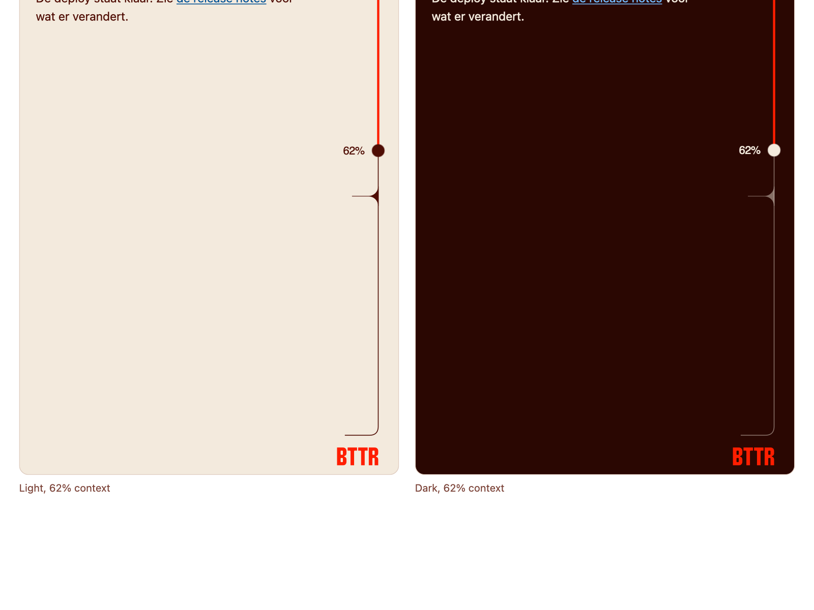

# BTTR Theme

A theme mod for Claude Code in the BTTR house style. It changes how the Claude desktop app looks; it adds no commands or tools.



## Install

From the BTTR organization library on claude.ai, or in Claude Code:

```
/plugin install bttr-context@claudeai-organization-library
```

From this repository, at the prompt of a terminal session:

```
/plugin install bttr-context --marketplace bttr-nl/claude-bttr-theme
```

From a shell:

```bash
claude plugin install bttr-context --marketplace bttr-nl/claude-bttr-theme
```

In the desktop app: click + next to the prompt box, then Plugins, Add marketplace with `bttr-nl/claude-bttr-theme`, then Add plugin.

## What it changes

- **Colours**: cream and white surfaces with dark-red text in light mode, the dark red of the bttr.nl hero card in dark mode. Links and the accent colour are sky blue.
- **Your messages**: a dark-red block in light mode and an orange block in dark mode, shaped like the buttons on bttr.nl.
- **Headings**: regular weight with tight letter spacing, like the large titles on the site.
- **Context rail**: a thin line on the right edge with the notch from the site's section dividers. A dot moves down it as the context window fills, with the percentage beside it. The dot turns orange from 80%. The BTTR logo sits under the rail.

## Limits

- The rail and the colours show in the desktop and mobile apps; the terminal keeps its own look.
- Mods can only pick a general font type, so the site's Alpes and SharpEarth fonts are not used.
- Permission prompts, questions, code blocks and the message box keep the app's own look.
